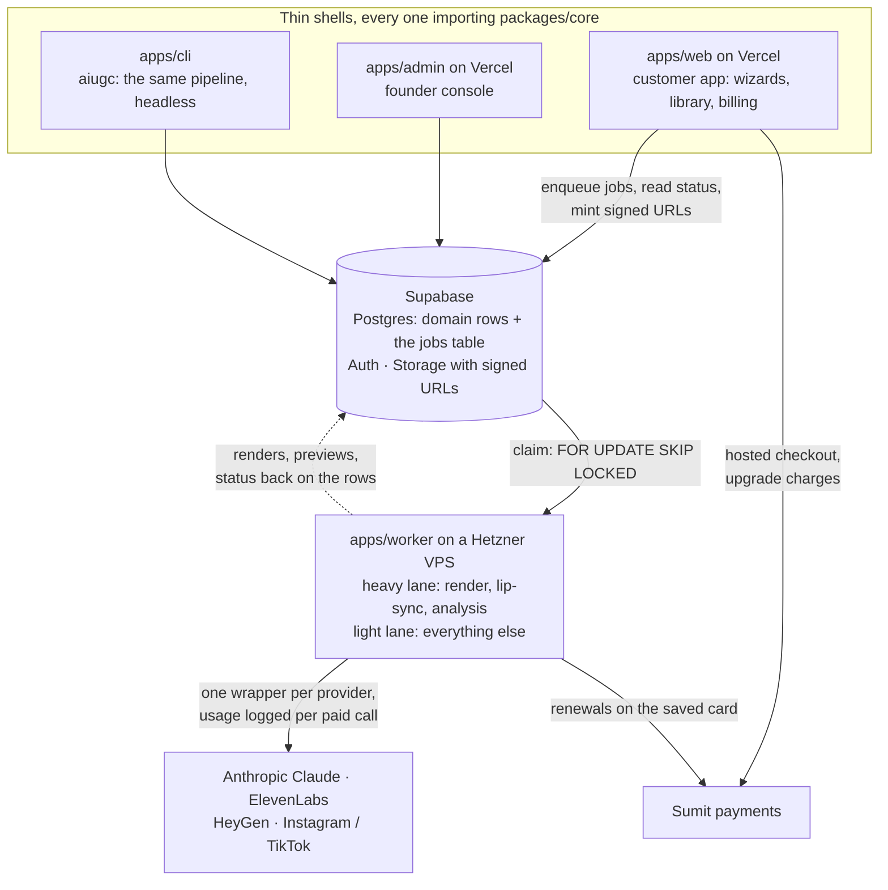
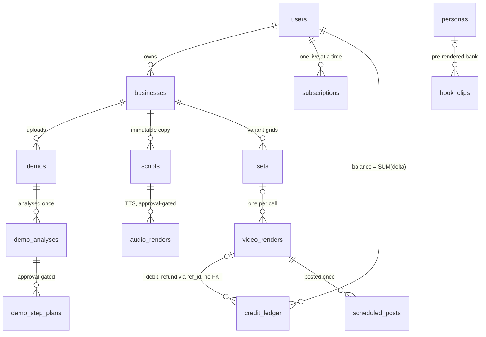
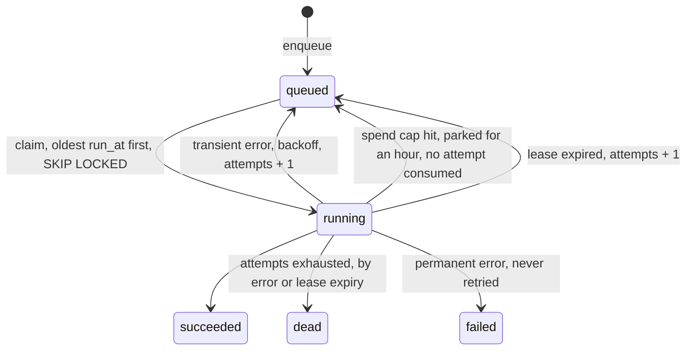

# Tavnit — Hebrew AI video ads, as a system

**Live at [tavnit.ai](https://tavnit.ai)** · in production with self-serve billing since 21 September 2026 · designed, built and operated by one person

Tavnit (תבנית, "template") turns a small Israeli business's phone-filmed product video, or just its answers to a short questionnaire, into vertical ads in Hebrew that are ready to post. Three ad formats share one render pipeline. The customer never touches a timeline: they pick, approve and caption; the system cuts, voices, lip-syncs and renders.

This README is written for someone evaluating the engineering. It covers the system design, the data model, and how the system is run. The product and backend specs are in [`docs/`](docs/00-overview.md); the decision log is in [`docs/vault/`](docs/vault/README.md).

## At a glance

|               |                                                                                                                                                                                                                                            |
| ------------- | ------------------------------------------------------------------------------------------------------------------------------------------------------------------------------------------------------------------------------------------ |
| **Product**   | A Hebrew, right-to-left self-serve web app: three ad formats, credits and subscriptions, scheduled posting to Instagram and TikTok, and a nightly autopilot that plans, renders and posts a day of content per connected Instagram account |
| **Shape**     | One TypeScript monorepo. A Next.js customer app and a founder console on Vercel; one long-running Node worker on a Hetzner VPS; Supabase (Postgres, Auth, Storage) between them                                                            |
| **Core idea** | Postgres is the queue. Every heavy step (vision analysis, TTS, lip-sync, ffmpeg, Remotion) is an idempotent, resumable job claimed with `FOR UPDATE SKIP LOCKED`. Nothing heavy ever runs in a serverless function                         |
| **AI**        | Claude for copy, for vision analysis of the customer's footage and for planning; ElevenLabs for Hebrew speech; HeyGen for lip-sync; Remotion (a real browser) for every frame of burned Hebrew text                                        |
| **Size**      | About 77k lines of TypeScript plus 56k lines of tests, 39 tables over 71 migrations, 19 job types, 700+ commits since July 2026 (counted 2026-11-17)                                                                                       |

## What it makes

Each format is a wizard in the app and a chain of jobs on the worker. The frames below come from real outputs, the example clips the dashboard shows; click one to play it.

<p align="center">
  <a href="apps/web/public/previews/hook-demo.mp4"></a>
  &nbsp;&nbsp;
  <a href="apps/web/public/previews/presenter.mp4"></a>
  &nbsp;&nbsp;
  <a href="apps/web/public/previews/text-block.mp4"></a>
</p>

| Hook + Demo (הוק + דמו)                                                                                                                                                                                                                                                                           | AI presenter (סרטון עם דמות AI)                                                                                                                                                                                                                                      | Text block (גוש טקסט)                                                                                                                                                                               |
| ------------------------------------------------------------------------------------------------------------------------------------------------------------------------------------------------------------------------------------------------------------------------------------------------- | -------------------------------------------------------------------------------------------------------------------------------------------------------------------------------------------------------------------------------------------------------------------- | --------------------------------------------------------------------------------------------------------------------------------------------------------------------------------------------------- |
| A 3–4 s pre-rendered reaction clip from a curated bank, a Hebrew hook line burned on it, hard cut into the customer's own screen recording, which is cut into labelled 2-second steps. Silent by design. One upload and one questionnaire yield many variants: hook clip × hook line × step plan. | A consistent AI persona with a pinned voice delivers a generated script: one reference selfie plus ElevenLabs audio through HeyGen lip-sync, karaoke captions timed from word alignment, a hook animation, and optional cutaways to the customer's own demo footage. | A founder-made clip plays once with its own sound under a block of Hebrew text written to read like a native TikTok or Instagram post, never like an ad. The customer edits the text and places it. |

## System design

### The big picture



Every box imports the same package. `packages/core` holds the pipelines, the queue, the schema and one wrapper per external provider; the apps are thin shells over it. The route handler that starts a render in the web app calls the same function the CLI calls.

### The decisions that shape it

1. **Postgres is the queue.** A plain `jobs` table and under a thousand lines of queue code (lanes and lease recovery included), instead of pg-boss, Trigger.dev or Inngest. The pipeline needs claim-time semantics a framework fights: parking a job when a spend cap is hit, a human approval in the middle of a chain, render concurrency pinned to one, credits reserved at enqueue. A claim is one `UPDATE … RETURNING` under `FOR UPDATE SKIP LOCKED`, so two workers can safely drain the same database (the production guard below turns a developer's worker away regardless). The table doubles as the ops dashboard.

2. **Every job is idempotent and resumable.** `idempotency_key` is UNIQUE (`render:<id>`, `janitor:2026-11-17`), so enqueueing twice returns the existing job. Paid external work is checkpointed into `jobs.state` _before_ the await: a lip-sync job stores HeyGen's request id the moment the submit is accepted, so a crash or a retry resumes polling instead of paying for a second GPU run.

3. **Failures are typed, and money follows them.** `PermanentError` (validation, 4xx) fails once and never retries. `TransientError` (5xx, 429, network) backs off exponentially, up to five attempts, then goes `dead`. `BudgetError` (a rolling 24-hour spend cap) parks the job for an hour with no attempt consumed. A job that dies holding a render fails the render and refunds its credits in the same breath, through an idempotent refund. A lease sweep requeues jobs whose worker died mid-run; a reaper catches renders orphaned by a crash before any handler ran.

4. **Status lives on domain rows, not on jobs.** Demos, audio previews and renders carry their own state machines; jobs are ephemeral executors. Human gates (the customer approving an audio preview; a founder QC-release gate that exists in code but is bypassed in production by a config flag) are modelled as _the absence of the next job_: the approval performs the state change and enqueues what comes next. No handler ever waits on a human.

5. **One worker, two lanes.** Heavy work (`render_video`, `lipsync`, `analyze_demo`) runs strictly one at a time; everything else runs on a light lane, so a one-minute render never blocks an audio preview. Scaling out is a second box with its own `WORKER_ID`; `SKIP LOCKED` already handles it.

6. **Money is an append-only ledger.** `credit_ledger` rows are inserted, never updated: `balance = SUM(delta)` per account; grants, debits, refunds and the monthly expiry of unused credits are all rows. The subscription state machine is ours, the payment gateway only executes charges, and every charge is logged under a UNIQUE gateway event id, so a replayed return or a re-run charge is a no-op. Renewals are scheduled by our daily job, never by the gateway.

7. **One wrapper per provider, and a keyless mode for all of them.** Each external service is one module with typed input and output, a timeout, error mapping into the failure taxonomy, and a `usage_events` row per paid call (tokens, characters, GPU seconds, estimated cost). `DRY_RUN=1` stubs every provider call deterministically, so the pipeline runs with no API keys against an in-process Postgres (PGlite): one e2e test drives the Hook + Demo and AI presenter chains end to end, human gates included, and the other chains have suites of their own.

8. **Prompts are versioned files.** `prompts/<name>/v<N>.md` with `{{var}}` interpolation; a revision is a new file, never an edit, and every generated row records its `prompt_version`, so any output traces back to the exact template. Claude calls use structured outputs validated with zod at the boundary.

9. **Policy is data.** Spend caps, retention windows, credit prices, the silence before speech, words-per-second calibration: all rows in one `app_config` table. Changing one is an UPDATE, not a deploy (the platform-wide runaway caps are migrations-only, by rule).

10. **Hebrew text is rendered by a browser.** Every burned caption, hook line and text block goes through Remotion (headless Chromium), because browser bidi handles right-to-left text correctly and ffmpeg `drawtext` does not. All output is 1080×1920 H.264 at 30 fps.

### Deliberate non-goals

- No timeline editor. Steps are cut automatically from the analysis; the customer picks and captions moments, never trims.
- No runtime face or video generation for hooks. Hook clips come only from a pre-rendered, curated bank.
- No video-to-video. An AI presenter is one reference image plus audio, nothing else.
- No new infrastructure, framework or paid service without a reason that survived the decision log.

### Security posture

- Supabase Auth with server-side cookies. The middleware refreshes the session on every request and sends unauthenticated visitors off `/home/*`.
- Row Level Security is enabled on every table: owner-scoped SELECT on a customer's own rows, catalog SELECT on the curated banks, and no policies at all on the server-only tables (`jobs`, `usage_events`, `gateway_events`, checkout state, social tokens, the autopilot), so a browser can never read those. Route handlers reach them through the service role after an explicit ownership check, and only then mint short-lived signed Storage URLs. Nothing business-scoped is served from a public bucket.
- Instagram and TikTok tokens are sealed in the OAuth callbacks with AES-256-GCM, bound to the owning account and platform as additional authenticated data, and opened only in the publish job, the daily token check and the sound-search route.
- The queue refuses a claim from any worker whose id marks it as local (`local:*`, `cli:*`), or from any `DRY_RUN` process, when it points at the production database. The guard exists because the incident it prevents was measured.
- The founder console is its own app, behind an admin-role check in the middleware and on every handler, with HTTP Basic auth across the whole origin in front of it (an env switch, on in production).
- A git pre-push hook refuses pushes to `main` from an AI session, and no migration is applied without an explicit instruction for that one operation.

## How a video gets made

Each handler enqueues its successor in code, and the hops a customer starts are written as such. There is no DAG engine.

```
Hook + Demo    ingest_demo ─▶ analyze_demo ─▶ group_analysis_states
               the customer picks a hook clip and hook lines, then asks for a step plan ─▶ plan_demo_steps
               ─▶ keeps and labels steps ─▶ createSet (one render row per variant, credits debited) ─▶ render_video ─▶ released

AI presenter   the script is generated in the route ─▶ the customer asks for audio ─▶ synth_tts ─▶ ⏸ the customer approves it ⏸
               ─▶ createBRender (debit) ─▶ lipsync: pad the lead-in ▶ submit ▶ checkpoint the id ▶ poll…
               ─▶ render_video (the one clip + captions + hook animation + cutaways) ─▶ released

Text block     serveNextTextBlock (a stored batch; the model runs only when the stock is empty)
               ─▶ content-policy gate ─▶ createTextBlockRender (debit) ─▶ render_video ─▶ released

Posting        schedulePosts (one transaction: N rows + N jobs, run_at = the instant) ─▶ publish_post
               Instagram: container ▶ poll ▶ publish   ·   TikTok: pull-from-URL into the owner's inbox

Nightly        autopilot_tick (a 60-second singleton) plans each Instagram account's day after 03:00 Israel time:
               one render at a time, scheduled through the same path, never the same hook line twice
Daily          janitor (retention) · billing_renewals · expire_trials · check_social_tokens
```

**Demo analysis** is the expensive, computed-once step behind Hook + Demo. ffmpeg samples the customer's screen recording; perceptual hashing clusters the frames into roughly 40–60 distinct UI states; representative frames go to Claude's vision in batches; the result is a timeline that the planner and the customer's picker both select from. Every step in the finished ad is a fixed 2-second clip placed from that footage, with a burned Hebrew label.

**Rendering** is one Remotion composition per format, rendered on the worker with `@remotion/renderer`. ffmpeg and ffprobe probe every upload and normalise it to 1080×1920 at 30 fps before anything else touches it. Measured on the production box: about 66 seconds of wall time per Hook + Demo video (mean of three renders, September 2026).

## Data model

Source of truth: [`packages/core/src/db/schema.ts`](packages/core/src/db/schema.ts) (Drizzle, 38 tables; `voice_recordings` is migration-only so far). 39 tables over 71 SQL migrations in [`supabase/migrations/`](supabase/migrations): generated DDL beside hand-written RLS, constraints and seeds.



**Rules the schema follows**

- IDs are `uuid`, timestamps are `timestamptz`.
- jsonb only where code owns the shape and validates it with zod at the boundary (the questionnaire, a set's grid, render params, word timestamps), never as an escape hatch.
- `credit_ledger` and `usage_events` are inserted, never updated, so invariants stay arithmetic; `events` and `gateway_events` only ever gain a notified or processed stamp.
- Scripts are immutable once referenced: an edit inserts a new row, so an audio render always points at the text that was actually spoken.
- Retention is enforced by the daily janitor from database timestamps: delete the object, null the path, keep the row, so stars and ledger references survive.

<details>
<summary><b>All 39 tables by domain</b></summary>

| Domain                | Tables                                                                                                                                                                                                                                                    |
| --------------------- | --------------------------------------------------------------------------------------------------------------------------------------------------------------------------------------------------------------------------------------------------------- |
| Identity and business | `users` (a mirror of `auth.users` with a customer/admin role), `businesses` (owner, the Hebrew questionnaire as jsonb), `terms_acceptances`, `feedback`                                                                                                   |
| Demo footage          | `demos` (uploaded → probing → normalizing → ready / rejected), `demo_analyses` (the UI-state timeline), `demo_analysis_footage` (held moments and picture-change instants), `demo_step_plans` (versioned, approval-gated), `cutaway_plans`                |
| Curated banks         | `personas`, `persona_images`, `hook_clips` (3–4 s reaction clips, each with a text-safe area), `text_block_clips`, `structures` (script skeletons rotated least-recently-used per business), `sounds`, `opener_clips` (a retired format; the table stays) |
| Copy and audio        | `scripts` (kind, text, `prompt_version`, immutable), `pronunciation_entries` (a find-and-replace map applied before TTS), `audio_renders` (the text as spoken, word timestamps, the `approved_at` gate), `voice_recordings`                               |
| Variants and renders  | `sets` (the grid: hook clips × hook lines; "more like this" is one insert), `video_renders` (queued → rendering → qc_pending when the gate is on → released / rejected / failed; `params` is the fully resolved cell), `composites`                       |
| Jobs and usage        | `jobs`, `usage_events` (one row per paid call), `events` (the analytics log), `app_config`                                                                                                                                                                |
| Billing               | `plans`, `subscriptions`, `credit_ledger`, `gateway_events`, `checkout_intents`, `intro_trials`, `orders`                                                                                                                                                 |
| Social and autopilot  | `social_accounts` (sealed tokens), `scheduled_posts`, `autopilot_setups`, `autopilot_accounts`, `autopilot_slots` (its unique indexes are the planning rules)                                                                                             |

</details>

### The jobs table

| Column                      | Role                                                                             |
| --------------------------- | -------------------------------------------------------------------------------- |
| `idempotency_key` UNIQUE    | one logical work item = one key; re-enqueueing returns the existing job          |
| `payload` jsonb             | ids only; the data lives on domain rows                                          |
| `state` jsonb               | the resumability checkpoint, written **before** awaiting an external side effect |
| `attempts` / `max_attempts` | failures count; claims do not                                                    |
| `run_at`                    | visibility time: backoff, poll rescheduling and budget parking all move it       |
| `locked_at` / `locked_by`   | the lease, and which machine holds it                                            |
| `error_class`               | `transient`, `permanent` or `budget`                                             |
| index on `(status, run_at)` | what the claim query reads                                                       |



## Repository layout

```
apps/web            Next.js 15 customer app: onboarding, the three wizards, the library,
                    billing, scheduling, the autopilot                          → Vercel
apps/admin          founder console: personas, clip banks, users, feedback      → Vercel
apps/worker         the production job loop: two lanes, Sentry, a systemd unit  → Hetzner VPS
apps/cli            `aiugc`: every pipeline step as a command
packages/core       the only place logic lives
  db/               the Drizzle schema and a driver-agnostic client (Postgres or PGlite)
  jobs/             queue, lanes, failure taxonomy, lease recovery, the daily scheduler
  providers/        one wrapper per external service, DRY_RUN stubs included
  pipelines/        the functions every app calls: demos, analysis, copy, TTS, renders,
                    credits, billing, checkout, social, autopilot, janitor
  media/            ffmpeg and ffprobe
packages/remotion   one composition per format, the hook animations, caption rendering
prompts/            versioned Claude prompts, prompts/<name>/v<N>.md
supabase/           71 migrations: generated DDL, RLS, seeds
docs/               design docs 00–10 and the vault
```

## Stack

| Layer    | Choice                                                                                                                                 |
| -------- | -------------------------------------------------------------------------------------------------------------------------------------- |
| Language | TypeScript 5 on Node 20+, pnpm workspaces                                                                                              |
| Web      | Next.js 15 (App Router, React 19), Tailwind 4, Supabase SSR auth, PostHog                                                              |
| Data     | Supabase Postgres through Drizzle ORM; PGlite in tests; Supabase Storage with private buckets and signed URLs                          |
| Jobs     | the Postgres `SKIP LOCKED` queue, pino logs, Sentry on the worker                                                                      |
| Media    | Remotion 4 (`@remotion/renderer`), ffmpeg and ffprobe                                                                                  |
| AI       | Anthropic SDK with structured outputs and zod (Claude Sonnet 5.5), ElevenLabs Eleven v4, HeyGen, fal.ai for product-in-hand composites |
| Payments | Sumit: a hosted checkout page for the first charge, API charges on the saved card for renewals, receipts issued automatically          |
| Social   | Meta Graph API (Instagram Reels), TikTok Content Posting API, Resend for email                                                         |
| Tests    | Vitest, 149 test files; one e2e test runs the Hook + Demo and AI presenter chains in DRY_RUN against PGlite                            |
| Hosting  | Vercel (web, admin), a Hetzner VPS under systemd (worker), Supabase cloud                                                              |

## Running it locally

```sh
pnpm install
cp .env.example .env            # with DRY_RUN=1 the whole pipeline runs without API keys
pnpm typecheck
pnpm --filter @aiugc/core exec vitest run --fileParallelism=false    # PGlite, no Docker
pnpm --filter @aiugc/cli dev -- --help
pnpm dev                        # the customer app on http://localhost:3000
```

The full test gate is seven serial commands (lint, typecheck, and one Vitest run per package); they are listed in [`CLAUDE.md`](CLAUDE.md). The end-to-end CLI workflow is in [`docs/06-cli-first.md`](docs/06-cli-first.md).

## How the project is run

- **One branch per task, pull requests into `main`, Vercel preview deploys as the check.**
- **A decision log instead of a wiki.** [`docs/vault/`](docs/vault/README.md) holds one claim per file, each with `status` and `verified` frontmatter and the command that produced it: 131 decisions, 104 measured facts, 74 defects, and 12 claims that were believed and later disproved, kept with what killed them. A note changes in the same commit as the code it describes.
- **AI-assisted, under a written protocol.** Most of the code was pair-programmed with Claude Code against [`CLAUDE.md`](CLAUDE.md): locked product decisions, a seven-command test gate, the branch-per-task rule, no database writes without an explicit instruction, and the pre-push hook that refuses `main`. The vault exists because the handover documents it replaced carried unverified claims forward until the code proved three of them wrong.

## Read next

| Document                                               | What it answers                                                  |
| ------------------------------------------------------ | ---------------------------------------------------------------- |
| [docs/00-overview.md](docs/00-overview.md)             | the architecture, environments and observability                 |
| [docs/01-schema.md](docs/01-schema.md)                 | every table, with the reasoning                                  |
| [docs/02-jobs.md](docs/02-jobs.md)                     | the queue, the failure taxonomy, lanes, idempotency per provider |
| [docs/04-integrations.md](docs/04-integrations.md)     | each provider's contract and the prompt files                    |
| [docs/05-billing.md](docs/05-billing.md)               | credits, subscriptions, the hosted checkout                      |
| [docs/09-social-posting.md](docs/09-social-posting.md) | the life of a post and the autopilot                             |
| [docs/vault/README.md](docs/vault/README.md)           | why the decision log exists                                      |
